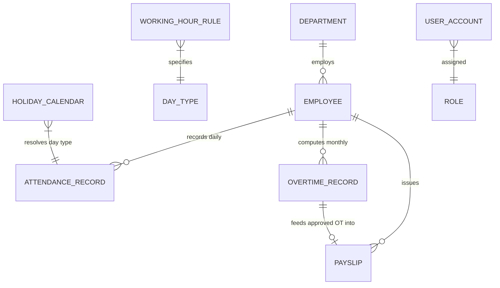

# Provert Payroll & Attendance Service (`finance_module`)

A production-grade, modular **Spring Boot (Java 21)** backend service engineered for employee lifecycle tracking, configurable work schedule rules, daily attendance capture, high-precision duration-based overtime (OT) computation, Sri Lankan statutory compensation deductions (EPF/ETF), approval locking workflows, and dynamic PDF payslip generation.

---

## 🌟 Key Features

* **Master Organization & Employee Profiles**: Department hierarchy, employee codes, designations, basic salaries, join dates, and soft-delete capabilities.
* **Configurable Working Hour Rules**: Rule-driven expected check-in/out schedules and OT multipliers (`Weekday`, `Saturday`, `Sunday`, `Holiday`).
* **Dynamic Day-Type Resolution**: Automatic resolution of daily attendance against the holiday calendar and days of the week, stored immutably on capture.
* **Duration-Based Overtime Engine**: Accurate time math via `java.time.Duration` (no brittle timestamp subtraction), configurable standard monthly divisors (default `208` hours), and weighted OT rates.
* **Sri Lanka Statutory Deductions (EPF / ETF)**:
  * **Employee EPF**: 8% deducted from basic salary.
  * **Employer EPF**: 12% paid by employer (not deducted from net salary).
  * **Employer ETF**: 3% paid by employer (not deducted from net salary).
* **Double-Lock Concurrency & Gating**:
  * Overtime recalculation is blocked (`409 Conflict`) once managerial approval is granted.
  * Payslip generation is gated on approved overtime (`400 Bad Request` if unapproved).
  * Payslip finalization permanently locks records against tampering (`409 Conflict`).
* **Branded PDF Payslip Generation**: Clean, corporate-grade PDF payslip downloads with earnings breakdown, statutory itemization, and audit timestamps.
* **Security & Role-Based Access Control (RBAC)**: Stateless JWT Bearer authentication with granular role enforcement (`ROLE_EMPLOYEE`, `ROLE_HR_ADMIN`, `ROLE_FINANCE_MANAGER`).
* **Interactive OpenAPI 3 / Swagger UI**: Visual API explorer with JWT Bearer authorization support.
* **Database Versioning via Flyway**: Clean MySQL migrations with audit columns (`created_at`, `updated_at`, `created_by`, `updated_by`).

---

## 🛠️ Technology Stack

| Layer | Component | Version / Notes |
|---|---|---|
| **Language & Runtime** | Java 21 | OpenJDK 21 LTS |
| **Framework** | Spring Boot 4.1.x | Spring Framework 7, Spring WebMVC |
| **Data & ORM** | Spring Data JPA / Hibernate | Entity auditing, filtered queries & pagination |
| **Database Migrations** | Flyway | MySQL 8.x schema versioning |
| **Security** | Spring Security + JWT | Stateless JWT token issuance via `com.auth0:java-jwt` |
| **PDF Generation** | OpenPDF | Clean styling and tables |
| **API Documentation** | Springdoc OpenAPI 3 | Swagger UI on `/swagger-ui.html` |
| **Testing** | JUnit 5, Mockito, Spring Security Test, H2 | 19 automated unit & integration tests |

---

## 📐 Architecture & Entity-Relationship Model



---

## 🔐 Role-Based Access Control (RBAC) Matrix

| Endpoint | Method | Permitted Roles | Description |
|---|---|---|---|
| `/api/auth/login` | POST | Public | Authenticate and obtain JWT token |
| `/api/auth/register` | POST | Public | Register new user account |
| `/swagger-ui/**`, `/v3/api-docs/**` | GET | Public | Interactive OpenAPI documentation |
| `/api/departments/**` | ALL | `ROLE_HR_ADMIN`, `ROLE_FINANCE_MANAGER` | Department master data |
| `/api/employees/**` | ALL | `ROLE_HR_ADMIN`, `ROLE_FINANCE_MANAGER` | Employee master data |
| `/api/working-hour-rules/**` | ALL | `ROLE_HR_ADMIN` | Schedule rules and multipliers |
| `/api/holidays/**` | ALL | `ROLE_HR_ADMIN` | Holiday calendar entries |
| `/api/attendance/**` | POST | `ROLE_HR_ADMIN`, `ROLE_EMPLOYEE`, `ROLE_FINANCE_MANAGER` | Capture attendance |
| `/api/attendance/**` | GET | Authenticated | Query attendance records |
| `/api/overtime/calculate` | POST | `ROLE_FINANCE_MANAGER` | Run monthly OT computation |
| `/api/overtime/{id}/approve` | PATCH | `ROLE_FINANCE_MANAGER` | Approve and lock OT record |
| `/api/payslips/generate` | POST | `ROLE_FINANCE_MANAGER` | Compute monthly payslips |
| `/api/payslips/{id}/finalize` | PATCH | `ROLE_FINANCE_MANAGER` | Permanently finalize and lock payslip |
| `/api/payslips/{id}/pdf` | GET | Authenticated | Download styled PDF payslip |

### Default Seeded Users (Initial Development Setup)

| Username | Password | Assigned Role |
|---|---|---|
| `finance_mgr` | `password123` | `ROLE_FINANCE_MANAGER` |
| `hr_admin` | `password123` | `ROLE_HR_ADMIN` |
| `employee1` | `password123` | `ROLE_EMPLOYEE` |

---

## 🧮 Business Logic & Calculation Formulas

### 1. Daily Overtime Math
For each attendance record where check-in and check-out exist:
$$\text{workedMinutes} = \text{Duration}(\text{checkIn}, \text{checkOut})$$
$$\text{expectedMinutes} = \text{Duration}(\text{expectedIn}, \text{expectedOut})$$
$$\text{otMinutes} = \max(0, \text{workedMinutes} - \text{expectedMinutes}) \quad [\text{if } \texttt{otEligible} = \text{true}]$$

### 2. Overtime Rate & Value
$$\text{hourlyRate} = \frac{\text{basicSalary}}{\text{monthlyStandardHours}} \quad (\text{default: } 208 \text{ hours})$$
$$\text{dailyOtAmount} = \frac{\text{hourlyRate}}{60} \times \text{otMinutes} \times \text{otMultiplier}$$

### 3. Sri Lanka Statutory Compensation & Net Pay
$$\text{grossPay} = \text{basicSalary} + \text{otAmount}$$
$$\text{employeeEpf} = \text{basicSalary} \times 8\%$$
$$\text{employerEpf} = \text{basicSalary} \times 12\% \quad (\text{Employer paid})$$
$$\text{employerEtf} = \text{basicSalary} \times 3\% \quad (\text{Employer paid})$$
$$\text{totalDeductions} = \text{employeeEpf} + \text{otherDeductions}$$
$$\text{netPay} = \text{grossPay} - \text{totalDeductions}$$

---

## 🚀 Quickstart & Execution Guide

### Prerequisites
* **Java 21** installed (`java -version`)
* **MySQL 8.x** running locally on port `3306`

### 1. Database Setup
Create the target MySQL database:
```sql
CREATE DATABASE IF NOT EXISTS payroll_db CHARACTER SET utf8mb4 COLLATE utf8mb4_unicode_ci;
```

Check your MySQL credentials in `src/main/resources/application.properties`:
```properties
spring.datasource.url=jdbc:mysql://localhost:3306/payroll_db?createDatabaseIfNotExist=true&useSSL=false&serverTimezone=UTC&allowPublicKeyRetrieval=true
spring.datasource.username=root
spring.datasource.password=Ajith@THALA.com
server.port=8085
```

### 2. Run All Tests
```powershell
.\mvnw.cmd test
```
Runs 19 automated tests (Day type resolution, OT math, statutory deductions, locks, PDF generation, security).

### 3. Start the Backend Server
```powershell
.\mvnw.cmd spring-boot:run
```
The server will start on **`http://localhost:8085`**.

### 4. Start the React Frontend Dashboard
Open a second terminal:
```powershell
cd frontend
npm run dev
```
Open your browser at 👉 **`http://localhost:5173`**.
* The frontend includes **quick-switch demo accounts** for `Finance Manager`, `HR Admin`, and `Employee`.
* Automatically proxies API calls to the backend on `http://localhost:8085`.

### 5. Interactive Swagger UI
Visit the Swagger documentation:
👉 **[http://localhost:8085/swagger-ui.html](http://localhost:8085/swagger-ui.html)**

---

## 🐙 Pushing to GitHub

The project has been initialized as an independent, clean Git repository inside `c:\Users\JANARTHTHAN\Desktop\finance_module` with full `.gitignore` coverage.

To push this project to your GitHub account:

1. **Create an empty repository on GitHub**:
   * Go to [github.com/new](https://github.com/new)
   * Name your repository (e.g. `payroll-finance-system` or `finance-module`).
   * **Do not** initialize with a README, .gitignore, or license (they are already included).

2. **Link and Push from your terminal**:
   ```powershell
   # 1. Add your GitHub repository remote
   git remote add origin https://github.com/<your-github-username>/<your-repo-name>.git

   # 2. Ensure default branch is main
   git branch -M main

   # 3. Push all commits to GitHub
   git push -u origin main
   ```

Click **Authorize** and enter your Bearer token after logging in via `/api/auth/login`.

---

## 📡 End-to-End API Walkthrough (cURL)

### 1. Login as Finance Manager
```bash
curl -X POST http://localhost:8085/api/auth/login \
  -H "Content-Type: application/json" \
  -d '{"username": "finance_mgr", "password": "password123"}'
```
*Save the returned `token` as `TOKEN`.*

### 2. Login as HR Admin
```bash
curl -X POST http://localhost:8085/api/auth/login \
  -H "Content-Type: application/json" \
  -d '{"username": "hr_admin", "password": "password123"}'
```
*Save the returned `token` as `HR_TOKEN`.*

### 3. Create Department
```bash
curl -X POST http://localhost:8085/api/departments \
  -H "Authorization: Bearer $HR_TOKEN" \
  -H "Content-Type: application/json" \
  -d '{"name": "Engineering", "code": "ENG"}'
```

### 4. Create Employee
```bash
curl -X POST http://localhost:8085/api/employees \
  -H "Authorization: Bearer $HR_TOKEN" \
  -H "Content-Type: application/json" \
  -d '{
    "employeeCode": "EMP-001",
    "fullName": "Janarththan",
    "designation": "Software Engineer",
    "departmentId": 1,
    "basicSalary": 104000.00,
    "joinedDate": "2025-01-01"
  }'
```

### 5. Configure Weekday Work Schedule
```bash
curl -X POST http://localhost:8085/api/working-hour-rules \
  -H "Authorization: Bearer $HR_TOKEN" \
  -H "Content-Type: application/json" \
  -d '{
    "dayType": "Weekday",
    "expectedIn": "09:00:00",
    "expectedOut": "17:00:00",
    "otEligible": true,
    "otMultiplier": 1.00
  }'
```

### 6. Record Daily Attendance (09:00 to 19:00 -> 2 hours OT)
```bash
curl -X POST http://localhost:8085/api/attendance \
  -H "Authorization: Bearer $HR_TOKEN" \
  -H "Content-Type: application/json" \
  -d '{
    "employeeId": 1,
    "attendanceDate": "2026-10-05",
    "checkIn": "2026-10-05T09:00:00",
    "checkOut": "2026-10-05T19:00:00"
  }'
```

### 7. Calculate Monthly Overtime
```bash
curl -X POST "http://localhost:8085/api/overtime/calculate?year=2026&month=10&employeeId=1" \
  -H "Authorization: Bearer $TOKEN"
```
*Returns 120 mins OT @ 500.00/hr = Rs. 1,000.00.*

### 8. Approve Overtime Record
```bash
curl -X PATCH http://localhost:8085/api/overtime/1/approve \
  -H "Authorization: Bearer $TOKEN" \
  -H "Content-Type: application/json" \
  -d '{"approvedBy": "FinanceManager"}'
```

### 9. Generate Monthly Payslip
```bash
curl -X POST "http://localhost:8085/api/payslips/generate?year=2026&month=10&employeeId=1&deductions=2000.00" \
  -H "Authorization: Bearer $TOKEN"
```
*Calculates:*
* Basic Salary: Rs. 104,000.00
* OT Pay: Rs. 1,000.00
* Gross Earnings: Rs. 105,000.00
* Employee EPF (8%): Rs. 8,320.00
* Other Deductions: Rs. 2,000.00
* Total Deductions: Rs. 10,320.00
* **Net Payable: Rs. 94,680.00**
* Employer EPF (12%): Rs. 12,480.00
* Employer ETF (3%): Rs. 3,120.00

### 10. Download Formatted PDF Payslip
```bash
curl -X GET http://localhost:8085/api/payslips/1/pdf \
  -H "Authorization: Bearer $TOKEN" \
  --output payslip-EMP-001.pdf
```

### 11. Finalize and Lock Payslip
```bash
curl -X PATCH http://localhost:8085/api/payslips/1/finalize \
  -H "Authorization: Bearer $TOKEN"
```
*Record is now permanently locked. Subsequent modifications return `409 Conflict` (`PAYSLIP_FINALIZED`).*
